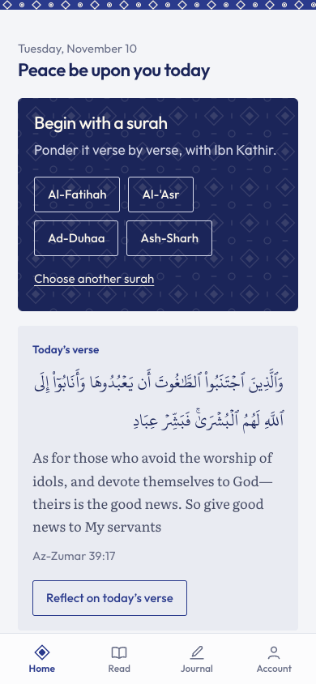
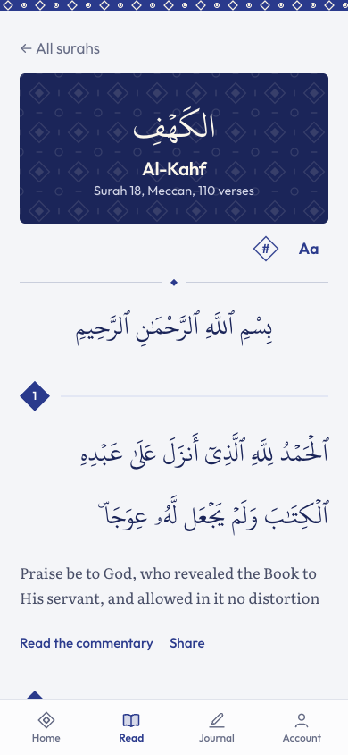
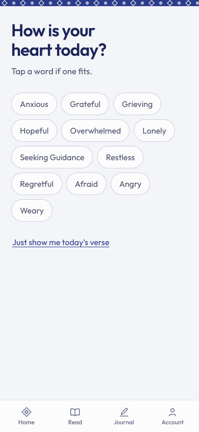
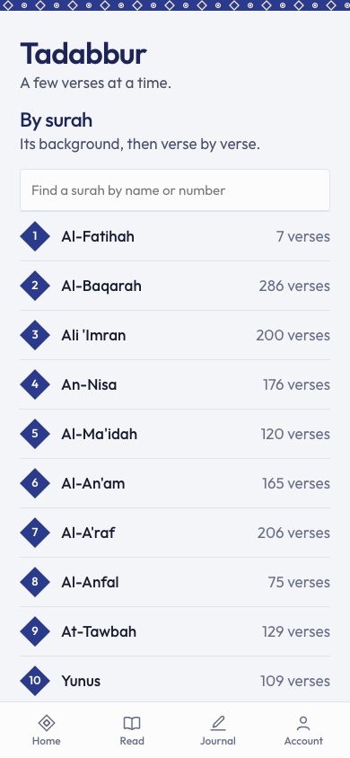

# MindfulVerse

A quiet app for pondering the Qur'an. Sit with one surah verse by verse with Ibn Kathir's commentary, keep a private journal for it, and get asked a week later whether you did what you wrote. Read it with friends in a circle, each in your own words.

It works in the browser and on Android, needs no sign up, and works offline. It is free, with no ads.

Live at [mindfulverse.vercel.app](https://mindfulverse.vercel.app)

## Features

- **Surah journal.** Begin with a surah: its background, then verse by verse with Ibn Kathir, and a page that keeps everything you wrote on it.
- **A week later.** Write what you will do; seven days on, Home asks how it went.
- **Circles.** Name a circle, pick a surah, share the link. Anyone can join without an account; reflections stay private, and the circle only sees an anonymous weekly count.
- **Tadabbur sessions.** Short guided reflections: a few verses on one theme.
- **Daily verse.** A verse for today and a place to write about it, with an optional daily reminder.
- **Read and search.** All 114 surahs with Arabic, English translation and commentary; search the translation or browse by theme.
- **Your rhythm.** Days of returning, and how many days this week you kept a reflection. Private, on your device.
- **Accounts and sync.** Optional sign in backs up your journal across devices.
- **For developers.** A free daily verse API for your own site, at `/developers`.

All Qur'an text, translation, and commentary are shown exactly as they are. The app never rewrites or generates religious content.

## Screenshots

| Home | Reader | Daily check-in |
| --- | --- | --- |
|  |  |  |

| Tadabbur sessions | Browse by theme | Dhikr and breath |
| --- | --- | --- |
|  |  |  |

## Run it

The repo holds the web app, the Android app and the code they share. Run everything from the root folder:

```bash
npm install
npm run dev          # starts the web app on your computer
```

The Qur'an data the app needs is already in `apps/web/public/data`.

| Command | What it does |
| --- | --- |
| `npm test` | Runs all the tests |
| `npm run build` | Checks the shared code for type errors, then builds the web app into `apps/web/dist` |
| `npm run preview` | Serves the built web app |
| `npm run typecheck` | Checks the shared code for type errors |
| `npm run test:e2e` | Runs the browser test in `apps/web/e2e`. It is skipped unless `E2E_EMAIL` and `E2E_PASSWORD` are set |

Keep `.env` and `.env.local` in the root folder. The web app reads them from there.

For the Android app, see [`apps/mobile/README.md`](apps/mobile/README.md).

## How it is built

The web app uses React, TypeScript and Vite. A service worker lets it work offline. All the Qur'an data ships with the app, and your journal is saved in your browser first. The only server is an optional [InsForge](https://insforge.dev) backend, used for accounts, sync and reminders.

```text
packages/core/        code shared by web and Android: data, journal,
                      progress, circles, sync and accounts
apps/web/             the web app: pages, components and the service worker
apps/mobile/          the Android app, built with Expo
apps/web/public/data/ the Qur'an, commentary, themes and sessions as JSON
functions/            InsForge server functions (reminders, daily verse API)
migrations/           InsForge database changes
scripts/              build-data.mjs, which turns the source datasets into app data
```

The shared code never calls browser or phone features directly. Each app sets it up once when it starts, by calling `configureInsforge`, `configureData`, `configureSyncTriggers` and `configureAnalytics`.

The source datasets for `npm run build:data` are not in the repo. If some Qur'an data looks wrong, please open an issue.

## Acknowledgments

The Qur'anic datasets come from the [Quranic Universal Library](https://qul.tarteel.ai) by [Tarteel](https://tarteel.ai). This app would not exist without their work.

The English translation is [ClearQuran](https://www.clearquran.com) by Talal Itani, used under the CC BY-NC-ND 4.0 licence. The Arabic typeface is the KFGQPC Uthmanic Hafs script from the King Fahd Glorious Qur'an Printing Complex in Madinah.

## Accounts and sync

You don't need to sign in. The whole app works signed out, offline, on your device. An account only backs up your journal and progress, so they follow you to another device. [InsForge](https://insforge.dev) provides sign in and the database. There is no other server.

| Setting | Used for |
| --- | --- |
| `VITE_INSFORGE_URL` | The address of the InsForge project |
| `VITE_INSFORGE_ANON_KEY` | The public key the app uses to talk to InsForge |
| `VITE_VAPID_PUBLIC_KEY` | The public key for the daily verse reminder in the browser |

For local work, put these in `.env` or `.env.local`. Copy `.env.example` to start. On Vercel, add all three under Project, Settings, Environment Variables, for both Production and Preview, then redeploy. Vite builds them into the app, so a change needs a new deploy.

Database changes are in `migrations/` and server functions are in `functions/`. You apply both to the InsForge project with the InsForge CLI. Nothing in this repo runs them for you.

How sync works:

- Everything is saved on the device first, so the app never waits for the network.
- When you sign in, come back online or return to the app, it fetches your saved journal and progress from your account.
- It joins them with what is on this device. Entries are matched by their id, and a deleted entry stays deleted. For progress, it keeps the furthest point you reached.
- It then sends back only what changed.
- Running sync twice, or on two devices at once, gives the same result. Nothing is duplicated or lost.

## Good to know

- The translation writes the divine name as "God". It is shown word for word, as its licence requires.
- Ibn Kathir wrote his commentary on passages, so some verses share a note with the verse next to them.
- Recitation audio and more languages are planned for later. MindfulVerse is free, with no paid plan. See `ROADMAP.md`.

## Licence

The code is under the [MIT License](LICENSE). The Qur'anic text, translation, commentary and fonts keep their own licences. See [LICENSE](LICENSE) and the Acknowledgments above. Want to help? See [CONTRIBUTING.md](CONTRIBUTING.md).
